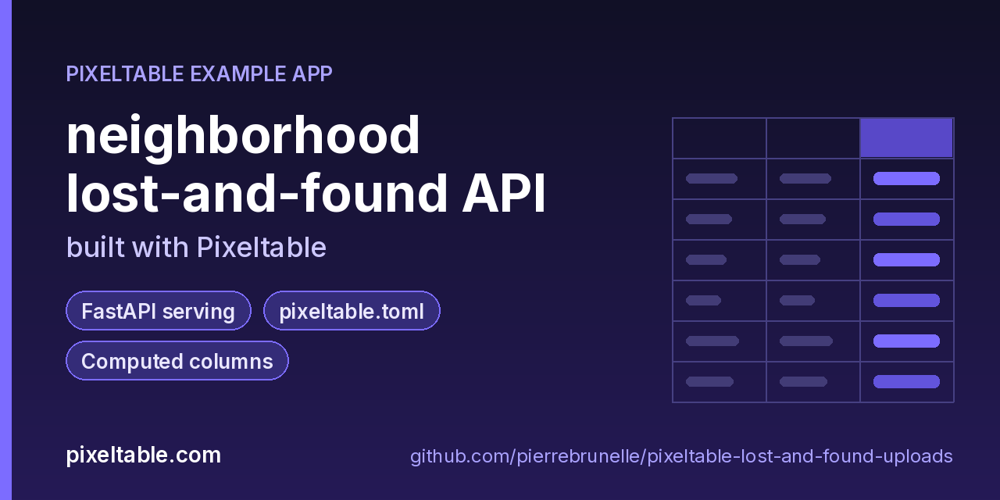

<!-- pixeltable-example-app: 20261114-lost-and-found-uploads -->
# Build an AI backend for user-uploaded images and video in Python

**Short answer:** declare a Pixeltable table with a `pxt.Image` column (and one with a `pxt.Video` column), put the derived media on computed columns (`photo.resize(...)` for a thumbnail, `video.extract_frame(...)` for a poster) with `destination=` pointing at a `pxt.ConfigVar` so each database writes to its own storage, add a vision-model caption column and a CLIP `EmbeddingIndex` on the photo. A `FastAPIRouter` turns the table into `POST /found` with `uploadfile_inputs=[photo]`: the upload is stored, thumbnailed, captioned and indexed in the same request. Text search and search-by-photo are `@pxt.query` functions exposed as routes. No separate object-storage glue, no edge functions, no vector extension.

**Replaces:** Supabase storage + edge functions + a vector extension

**Use case:** [pixeltable.com/learn/what-is-a-multimodal-backend](https://pixeltable.com/learn/what-is-a-multimodal-backend)



[](https://codespaces.new/pierrebrunelle/pixeltable-lost-and-found-uploads?quickstart=1)
[](https://pixeltable.com)
[](https://pypi.org/project/pixeltable/)
[](https://github.com/pixeltable/pixeltable)
[](LICENSE)

`Found` holds one row per found item: the uploaded `photo` (`pxt.Image`), where and when it was found, who found it and a status. Computed columns write a 320x240 `thumb` to the destination bound to the `thumb_dest` config var, read the image metadata, name the dominant color (a small PIL UDF) and ask `gpt-4o-mini` (low-detail vision) for a one-sentence caption. A CLIP `EmbeddingIndex` on the photo powers both text-to-image search (`/search?q=black wallet`) and image-to-image search (`POST /search/photo` with an uploaded photo). `Clips` takes short videos (a bike too big to carry home), stores the duration and a poster frame (`extract_frame`) and indexes the poster with CLIP. `LostReports` is the other side: inserting a description runs `search_text` as a computed column and stores the three closest found items with their scores. The `FastAPIRouter` serves multipart uploads (synchronous and as a background job), status updates, deletes, the searches and the stored thumbnail as a file.

[Pixeltable](https://pixeltable.com) is open-source, Python-native **multimodal AI data infrastructure**: tables, incremental computed columns, UDFs, indexes and serving in one library, running locally or on Pixeltable Cloud.

> ⭐ **Like this example?** Star [pixeltable/pixeltable](https://github.com/pixeltable/pixeltable) on GitHub. It helps other developers find it.

## What this example shows

- **FastAPI serving**: one `FastAPIRouter` turns tables and `@pxt.query` functions into typed REST routes (insert, update, delete, compute and query) with OpenAPI docs
- **Incremental computed columns** powered by plain Python UDFs (`@pxt.udf`)
- **B-tree indexes** declared on the model (`__indexes__`) back the lookup queries
- **Multimodal media columns** with configurable media destinations
- **Importable UDF module**: UDFs live in `udfs.py`; tables, queries and routes live together in `app.py` (Pixeltable resolves UDFs by module path)
- **`pixeltable.toml`** declares a local database and a **Pixeltable Cloud** database, so the same code deploys with `pxt db update`

## Pipeline

| Table / column | Built with | What it holds |
|---|---|---|
| `found.photo` | `pxt.Image` (multipart upload) | the uploaded photo |
| `found.thumb` | `photo.resize([320, 240])`, `destination=THUMB_DEST` | thumbnail written to the bound media destination |
| `found.meta` | `photo.get_metadata()` | width, height, mode, format |
| `found.color` | `color_hint` UDF (PIL quantize) | dominant color name |
| `found.caption` | `openai.chat_completions` (`gpt-4o-mini`, low-detail image) | one-sentence description |
| `photo_clip` | `EmbeddingIndex` + CLIP ViT-B/32 | text and image search on photos |
| `clips.poster` | `video.extract_frame(timestamp=1.0)`, `destination=THUMB_DEST` | poster frame of each clip |
| `lost_reports.matches` | `search_text` (`@pxt.query`) + `shortlist` UDF | closest found items for a description |

## Routes

| Route | Kind | What it does |
|---|---|---|
| `POST /found` | insert, multipart | upload a found-item photo; thumbnail, caption, color, index in the same request |
| `POST /found/background` | insert, multipart, background job | same, returns a `job_url` to poll |
| `POST /found/clip` | insert, multipart | upload a short video; duration + poster frame |
| `POST /found/status` | update | set `open` / `claimed` / `returned` by `item_id` |
| `POST /found/delete` | delete | remove a found item |
| `POST /lost` | insert | describe a lost item, get the closest found items |
| `GET /search` | query | text-to-image search |
| `POST /search/photo` | query, multipart | search with a photo (not stored) |
| `GET /clips/search` | query | search video posters |
| `GET /found/recent` | query | latest found items |
| `GET /found/thumb` | query, file response | the stored thumbnail |

## Config vars and per-database media destinations

`THUMB_DEST = pxt.ConfigVar('thumb_dest', pxt.URI)` is declared in `app.py` and used as `destination=` on both media columns. Each `[[pixeltable.database]]` entry in `pixeltable.toml` binds it (`vars.thumb_dest = ...`), so a hosted database can point at a bucket while your laptop writes to a folder. `pxt config --section pixeltable.database.vars` shows the bound value and where it came from. A local destination must be outside the project directory.

## Photo credits

Demo photos are from Wikimedia Commons (CC0 / CC BY / CC BY-SA); titles, licenses and source pages are in `data/photos/CREDITS.json`. The two clips are short pans over two of those photos.

## What's inside

| File | What it is |
|------|------------|
| `.devcontainer/devcontainer.json` | GitHub Codespaces / Dev Container config: Python 3.12, installs `requirements.txt`, forwards port 8000 |
| `.github/social-preview.png` | Social preview image (1280x640) |
| `CITATION.cff` | Citation metadata (authors, license, release date, keywords) |
| `app.py` | The app: tables declared as Python classes, `@pxt.query` functions, and the `FastAPIRouter` routes |
| `data/clips/backpack-bus-stop.mp4` | Sample data |
| `data/clips/bike-at-park-gate.mp4` | Sample data |
| `data/my-old-wallet-photo.jpg` | Sample data |
| `data/photos/CREDITS.json` | Sample data |
| `data/photos/backpack.jpg` | Sample data |
| `data/photos/bicycle.jpg` | Sample data |
| `data/photos/cat.jpg` | Sample data |
| `data/photos/glove.jpg` | Sample data |
| `data/photos/headphones.jpg` | Sample data |
| `data/photos/keys.jpg` | Sample data |
| `data/photos/scarf.jpg` | Sample data |
| `data/photos/teddy.jpg` | Sample data |
| `data/photos/umbrella.png` | Sample data |
| `data/photos/wallet.jpg` | Sample data |
| `data/photos/water_bottle.jpg` | Sample data |
| `pixeltable.toml` | Project config: the local database plus a Pixeltable Cloud database (sizing, deploy excludes) |
| `seed.py` | Load the demo found items and two lost reports |
| `udfs.py` | Pixeltable UDFs (`@pxt.udf`) in their own importable module, imported by `app.py` |
| `requirements.txt` / `pyproject.toml` | Dependencies (`pixeltable[serve]>=0.7.24`) |

**Tables**

| Table | Stored columns | Computed columns |
|-------|---------|------------------|
| `found` | `photo`, `spot`, `found_on`, `finder`, `status` | `item_id`, `thumb`, `meta`, `color`, `vision`, `caption` |
| `clips` | `video`, `spot`, `finder` | `clip_id`, `duration`, `poster` |
| `lost_reports` | `description`, `lost_near`, `contact` | `report_id`, `hits`, `matches` |

**API routes** (service `lostfound`)

| Method | Path | Kind | Backed by | Notes |
|--------|------|------|-----------|-------|
| `POST` | `/found` | insert | `Found` |  |
| `POST` | `/found/background` | insert | `Found` | background job |
| `POST` | `/found/clip` | insert | `Clips` |  |
| `POST` | `/found/status` | update | `Found` |  |
| `POST` | `/found/delete` | delete | `Found` |  |
| `POST` | `/lost` | insert | `LostReports` |  |
| `GET` | `/search` | query | `search_text` |  |
| `POST` | `/search/photo` | query | `search_photo` |  |
| `GET` | `/clips/search` | query | `search_clips` |  |
| `GET` | `/found/recent` | query | `recent_found` |  |
| `GET` | `/found/thumb` | query | `thumbnail` |  |

## Run in your browser (GitHub Codespaces)

[](https://codespaces.new/pierrebrunelle/pixeltable-lost-and-found-uploads?quickstart=1)

1. Click **Open in GitHub Codespaces** above (or [this link](https://codespaces.new/pierrebrunelle/pixeltable-lost-and-found-uploads?quickstart=1)). The dev container installs Python 3.12 and `pixeltable[serve]>=0.7.24` from `requirements.txt`.
2. In the codespace terminal, create the tables, seed them and start the API:

   ```bash
   pxt schema update app.py lostfound
   export OPENAI_API_KEY=...   # gpt-4o-mini captions (one low-detail vision call per photo)
   mkdir -p /tmp/lostfound-media/thumbs   # thumb_dest in pixeltable.toml; any absolute path or bucket outside the project dir
   pxt schema update app.py lostfound
   python seed.py              # 8 found photos, 2 video clips, 2 lost reports
   pxt service run app.py lostfound --port 8000   # open http://localhost:8000/docs
   ```

3. Codespaces forwards port 8000: open it from the **Ports** tab (or the pop-up) and add `/docs` to the URL for the interactive OpenAPI docs.

## Quickstart

Requires Python 3.11+ and `pixeltable[serve]>=0.7.24`.

```bash
git clone https://github.com/pierrebrunelle/pixeltable-lost-and-found-uploads.git
cd pixeltable-lost-and-found-uploads
python -m venv .venv && source .venv/bin/activate
pip install -r requirements.txt

# Create the tables in a local catalog directory named `lostfound`
pxt schema update app.py lostfound

export OPENAI_API_KEY=...   # gpt-4o-mini captions (one low-detail vision call per photo)
mkdir -p /tmp/lostfound-media/thumbs   # thumb_dest in pixeltable.toml; any absolute path or bucket outside the project dir
pxt schema update app.py lostfound
python seed.py              # 8 found photos, 2 video clips, 2 lost reports
pxt service run app.py lostfound --port 8000   # open http://localhost:8000/docs
```

Try it:

```bash
curl -s -X POST localhost:8000/found -F spot='Dog park bench' -F found_on=2026-11-14 -F finder=Ana -F status=open -F photo=@data/photos/cat.jpg
curl -s -X POST localhost:8000/found/clip -F spot='Park gate, north entrance' -F video=@data/clips/bike-at-park-gate.mp4
curl -s 'localhost:8000/search?q=black%20leather%20wallet&k=3'
curl -s -X POST localhost:8000/search/photo -F photo=@data/my-old-wallet-photo.jpg -F k=2
curl -s -X POST localhost:8000/lost -H 'content-type: application/json' -d '{"description":"grey cat with a collar","lost_near":"dog park","contact":null}'
curl -s -X POST localhost:8000/found/status -H 'content-type: application/json' -d '{"item_id":"<item_id>","status":"returned"}'
curl -s -o thumb.jpg 'localhost:8000/found/thumb?item_id=<item_id>'
```

## Deploy to Pixeltable Cloud

The same `app.py` runs on [Pixeltable Cloud](https://pixeltable.com). Sign in (or get a free trial database with `pxt new`), point the second database entry in `pixeltable.toml` at your own database, then deploy:

```bash
pxt login                       # or: export PIXELTABLE_API_KEY=<your-api-key>
# edit pixeltable.toml: name = 'pxt://<your-org>:<your-db>'
pxt db update pxt://<your-org>:<your-db>                 # build the image and upload the project
pxt schema update app.py pxt://<your-org>:<your-db>       # create the tables at the database root (no per-app folder)
pxt service update app.py pxt://<your-org>:<your-db>      # start the API there
pxt service list pxt://<your-org>:<your-db>              # list hosted services
```

Hosted routes require an API key: send it in the `X-api-key` header (for example `-H "X-api-key: $PIXELTABLE_API_KEY"`). Keep keys in environment variables or `pxt secret set`, never in code.

## Code walkthrough

**1. Business logic is plain Python, in `udfs.py`.** A `@pxt.udf` function can be used as a column expression. Pixeltable records UDFs by module path (`udfs.color_hint`), so they live in their own importable module rather than inline in the app: the daemon, serving workers and Pixeltable Cloud import it again by that path.

```python
# udfs.py
@pxt.udf
def color_hint(img: PIL.Image.Image) -> str:
    """Name of the palette color closest to the image's most common color (after quantizing to 4 colors)."""
    small = img.convert('RGB').resize((64, 64))
    q = small.quantize(colors=4)
    palette = q.getpalette() or []
    counts = sorted(q.getcolors() or [], reverse=True)
    if not counts:
        return 'unknown'
    idx = counts[0][1]
    rgb = tuple(palette[idx * 3 : idx * 3 + 3])
    return min(_PALETTE, key=lambda name: sum((a - b) ** 2 for a, b in zip(_PALETTE[name], rgb)))
```

**2. Tables are Python classes (`app.py`).** Annotated attributes are stored columns; attributes assigned an expression are **computed columns** (`item_id`, `thumb`, `meta`, `color`, `vision`, `caption`), evaluated incrementally on every insert or update and recomputed when their inputs change. Indexes live next to the columns.

```python
# app.py
class Found(TableModel, name='found'):
    """One found item, reported with a photo."""

    item_id = pxt.Column(value=pxtf.uuid.uuid7(), primary_key=True)
    photo: pxt.Image
    spot: pxt.String
    found_on: pxt.String | None
    finder: pxt.String | None
    status: pxt.String | None  # open / claimed / returned

    thumb = photo.resize([320, 240])
    meta = photo.get_metadata()
    color = color_hint(thumb)
    vision = openai.chat_completions(
        vision_messages(CAPTION_PROMPT, thumb), model=CAPTION_MODEL, model_kwargs={'max_tokens': 60, 'temperature': 0}
    )
    caption = vision.choices[0].message.content.astype(pxt.String)

    __indexes__ = [pxt.EmbeddingIndex(photo, embedding=CLIP, name='photo_clip'), pxt.BtreeIndex(status)]
```

**3. Queries are functions (`app.py`).** `@pxt.query` wraps a Pixeltable query so it can be called from Python or exposed as a route:

```python
# app.py
@pxt.query
def search_text(q: str, k: int = 3):
    """Found items whose photo best matches a text description (CLIP text-to-image)."""
    sim = Found.photo.similarity(string=q, idx='photo_clip')
    return (
        Found.where(Found.status != 'returned')
        .order_by(sim, asc=False)
        .limit(k)
        # item_id as text: a UUID inside a query result stored as a JSON column must be a string
        .select(item_id=pxtf.uuid.to_string(Found.item_id), spot=Found.spot, caption=Found.caption, color=Found.color, status=Found.status, score=sim)
    )
```

**4. One router, a full REST API.** `FastAPIRouter` generates request/response models from the column types, validates input, and publishes OpenAPI docs at `/docs`:

```python
# app.py
lostfound = FastAPIRouter(name='lostfound')
lostfound.add_insert_route(
    Found,
    path='/found',
    inputs=[Found.spot, Found.found_on, Found.finder, Found.status],
    uploadfile_inputs=[Found.photo],
    outputs=[Found.item_id, Found.caption, Found.color, Found.meta],
)
lostfound.add_insert_route(
    Found,
    path='/found/background',
    inputs=[Found.spot, Found.found_on, Found.finder, Found.status],
    uploadfile_inputs=[Found.photo],
    outputs=[Found.item_id, Found.caption, Found.color],
    background=True,
)
lostfound.add_insert_route(
    Clips,
    path='/found/clip',
    inputs=[Clips.spot, Clips.finder],
    uploadfile_inputs=[Clips.video],
    outputs=[Clips.clip_id, Clips.duration],
)
lostfound.add_update_route(Found, path='/found/status', inputs=[Found.status], outputs=[Found.item_id, Found.status])
lostfound.add_delete_route(Found, path='/found/delete')
lostfound.add_insert_route(
    LostReports,
    path='/lost',
    inputs=[LostReports.description, LostReports.lost_near, LostReports.contact],
    outputs=[LostReports.report_id, LostReports.matches],
)
lostfound.add_query_route(path='/search', query=search_text, method='get')
# ... more routes in app.py
```

## FAQ

**How do I build an AI backend for user-uploaded images and video in Python?**

Declare tables with `pxt.Image` / `pxt.Video` columns, add computed columns for what you derive from each upload (thumbnail, poster frame, caption, metadata) and an embedding index for search, then expose the table with `FastAPIRouter.add_insert_route(..., uploadfile_inputs=[photo])`. Each multipart upload is stored and processed in the same request. This repo is that, end to end, in about 150 lines.

**Where do the uploaded files and thumbnails go?**

Uploaded files are stored by Pixeltable. Computed media (thumbnails, poster frames) go to the column's `destination=`. Here the destination is a `pxt.ConfigVar('thumb_dest', pxt.URI)`, bound per database in `pixeltable.toml` under `vars.thumb_dest`, so the same code writes to a local folder in development and to an object-store URI elsewhere. A `PIXELTABLE_VAR_THUMB_DEST` environment variable also binds it.

**Can people search with a photo instead of words?**

Yes. The CLIP index on `photo` answers both `similarity(string=...)` and `similarity(image=...)`. `POST /search/photo` is a query route with `uploadfile_inputs=['photo']`: the uploaded photo is embedded and compared without being stored.

**What is this a Supabase alternative for?**

Instead of a storage bucket, an edge function per processing step and a vector extension, the files, derived media, captions, embeddings and search live in one Pixeltable schema. Adding a new derived column (say, an OCR pass for name tags) backfills existing uploads and runs on every new one.

**How do I trace it in SigNoz or another OpenTelemetry backend?**

Install `pixeltable[otel]`, set `OTEL_EXPORTER_OTLP_ENDPOINT` (e.g. `http://localhost:4318` for a self-hosted SigNoz collector) and run `pxt service run app.py lostfound --otel`. Every request becomes a trace with Pixeltable spans (insert, media save, CLIP and chat-completion UDF calls) under the FastAPI request span, and token and row metrics are exported too.

## Learn more

- 🌐 Website: https://pixeltable.com
- 📚 Docs: https://docs.pixeltable.com
- 💻 Source: https://github.com/pixeltable/pixeltable (⭐ star it if Pixeltable is useful to you)
- 📦 PyPI: https://pypi.org/project/pixeltable/
- 🎯 Use case: https://pixeltable.com/learn/what-is-a-multimodal-backend
- 🧩 More example apps: https://pierrebrunelle.github.io/awesome-pixeltable-apps/

**[More Pixeltable example apps →](https://pierrebrunelle.github.io/awesome-pixeltable-apps/)**

---

<sub>Built as part of a daily series of Pixeltable example apps · Pixeltable 0.7.24 · Python, FastAPI, incremental computed columns · Licensed under Apache-2.0.</sub>
